<div align="center">

# ✨ Givrelune

**Un marché de Noël en 3D, cosy et open source, où chaque cabane est une vraie boutique.**

Promène-toi à la tombée de la nuit dans le village enneigé de Givrelune, discute avec les artisans,
découvre leurs créations et file sur leur site. Une petite histoire t'attend : le vent du Nord a
dispersé les sept étoiles de verre du Grand Sapin…

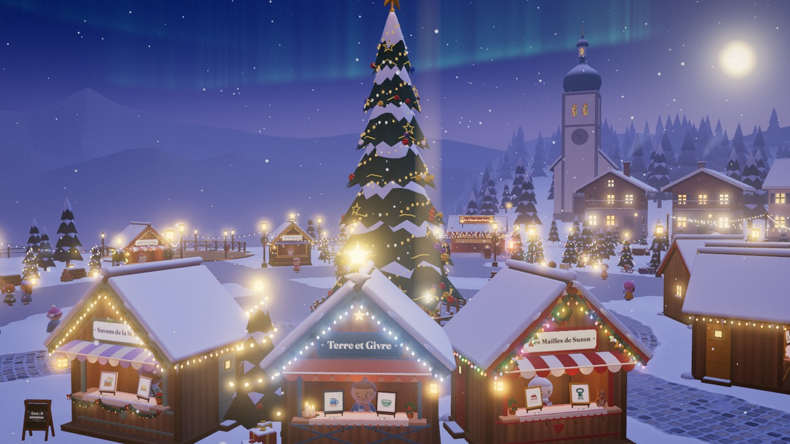

</div>

## Ce que c'est

Givrelune est un **e-commerce façon jeu vidéo cosy** : un marché de Noël en 3D qui tourne dans le
navigateur, sur ordinateur comme sur téléphone. Le projet est fait pour être **forké** : tu crées ton
propre marché, ou un collectif d'artisans crée le sien, en éditant des fichiers JSON. Pas besoin de coder.

- 🏡 **Une cabane par artisan** : couleurs, enseigne et décorations sont personnalisables, l'ordre des produits et des décos aussi.
- 🎁 **De vrais produits** : image, nom, prix et lien vers la boutique, récupérés automatiquement depuis le site de l'artisan (JSON-LD, OpenGraph, Shopify, WooCommerce).
- 💬 **Des artisans qui parlent, sans IA** : pose une question (« Tu livres ? », « C'est fait en quoi ? »). La réponse vient des textes de l'artisan et de son site, grâce à un petit moteur de recherche qui comprend le français. Si l'artisan ne vend pas ce que tu cherches, il t'envoie chez le bon voisin (« va voir Gaspard à L'Établi de Gaspard ! ») ou au bon endroit du marché.
- 🌙 **Une ambiance** : heure bleue, neige qui tombe, illuminations qui s'allument en vague, aurore boréale, boîte à musique.
- 🎶 **Une musique générée en direct** : chants de Noël du domaine public joués par une boîte à musique synthétisée. Tu choisis la playlist et tu peux ajouter tes propres morceaux.
- ⭐ **Une petite quête et des mini-jeux** : l'attrape-flocons, le chamboule-neige, les crêpes de Paulette, le souffle du verrier, le pompon du manège… et un final illuminé.
- 🗺️ **Une carte** pour se déplacer d'un lieu à l'autre.
- 🎮 **Au clavier** (ZQSD, WASD ou flèches) ou **sur téléphone** (joystick, toucher le sol).
- 🛠️ **L'Atelier des cabanes** : un éditeur visuel pour créer sa cabane, réordonner produits et décorations par glisser-déposer et tester la conversation.

## En images

| | |
|---|---|
| 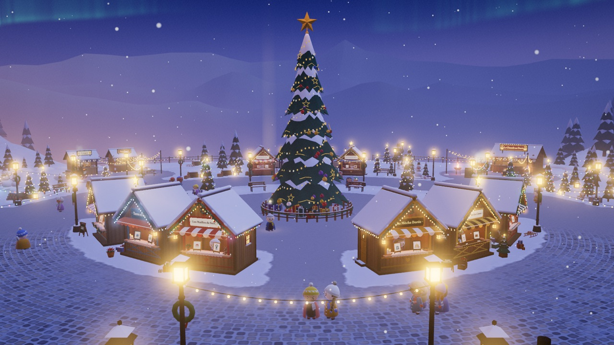 | 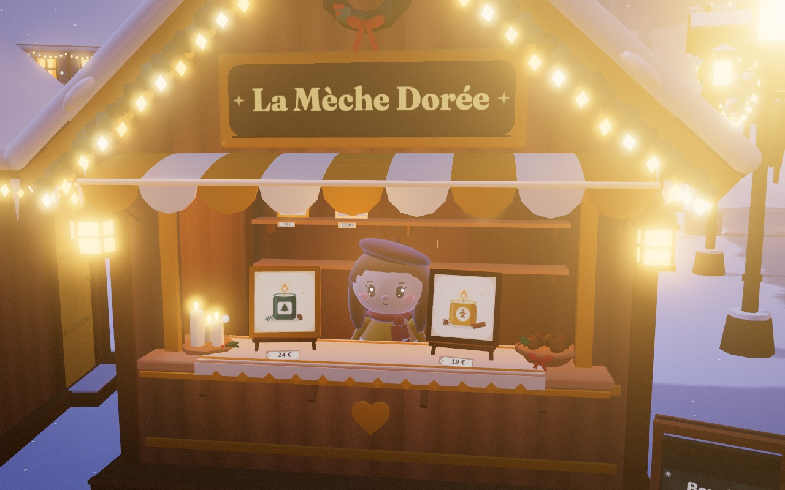 |
| *L'arrivée : les cabanes accueillent le visiteur, le Grand Sapin derrière* | *Chaque cabane est construite à partir de son fichier JSON* |
| 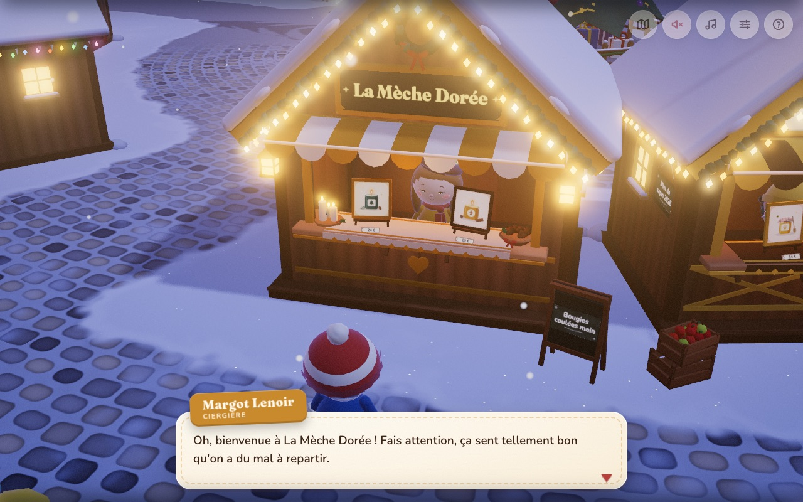 | 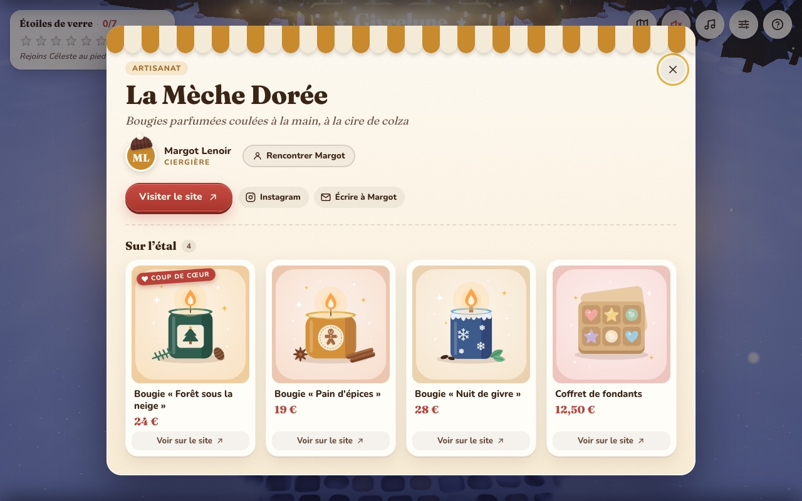 |
| *On discute, et on pose ses questions librement* | *La vitrine : produits, prix et liens vers la boutique* |
| 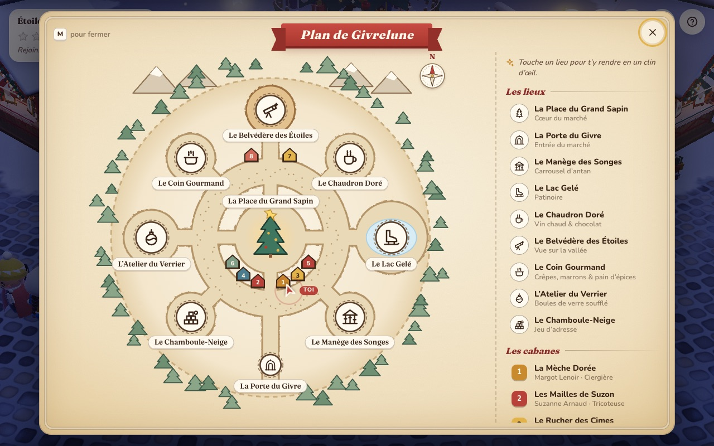 |  |
| *La carte, pour se rendre partout en un clin d'œil* | *Le Lac Gelé, l'église à bulbe et l'aurore* |
| 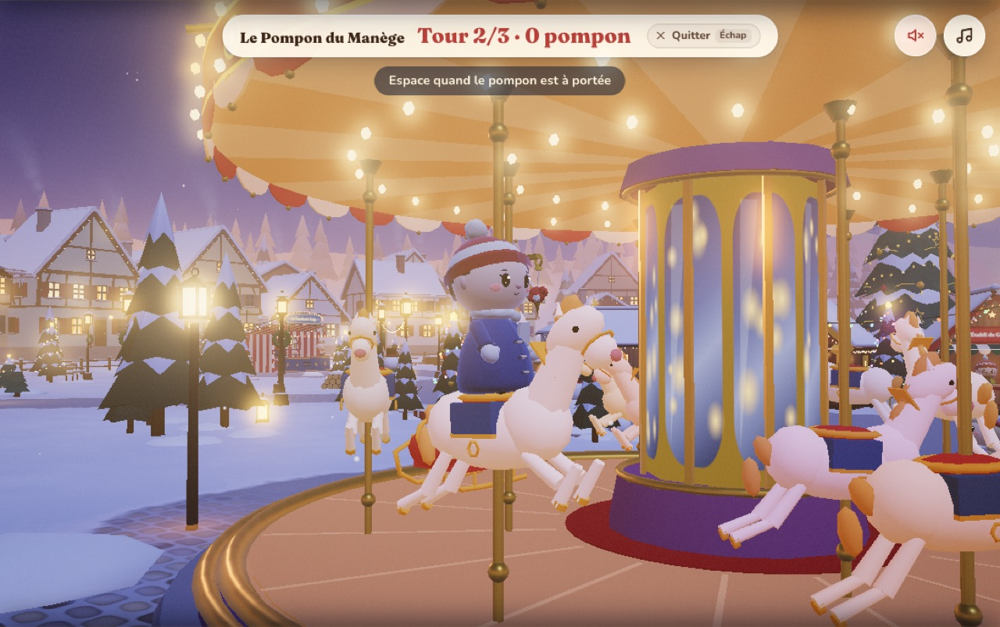 | 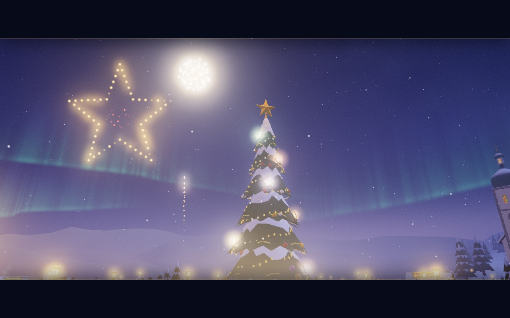 |
| *Cinq mini-jeux cosy, comme le pompon du manège* | *Les sept étoiles retrouvées : le final* |
| 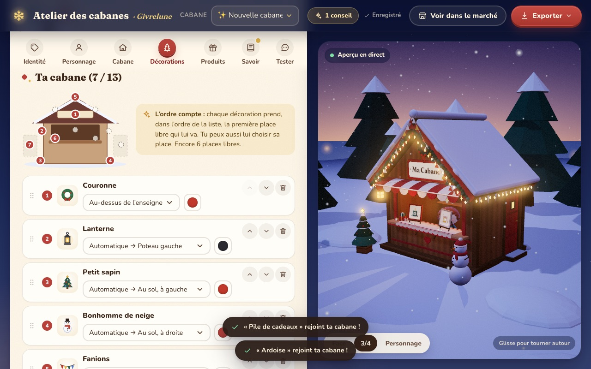 | 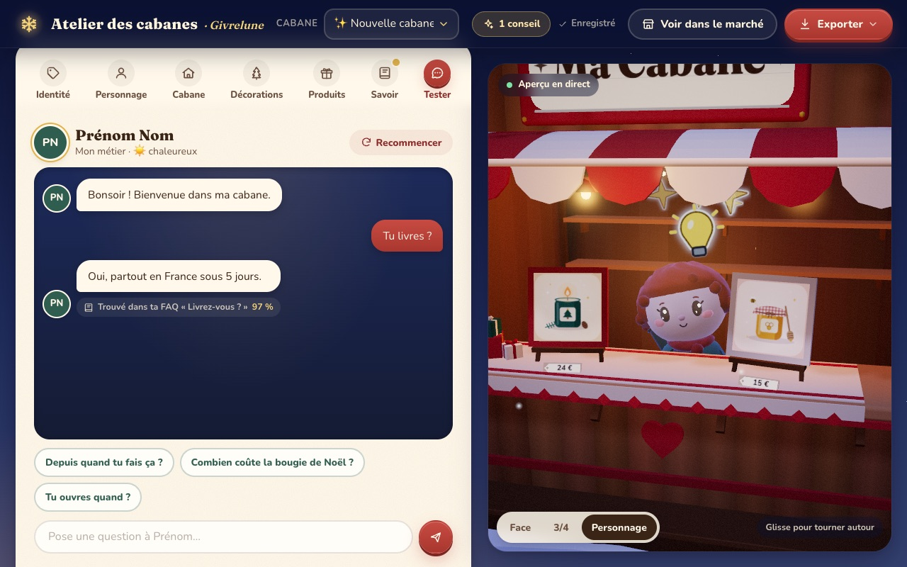 |
| *L'Atelier des cabanes : créer sa cabane sans coder* | *…et tester ce que répondra son personnage* |

<p align="center">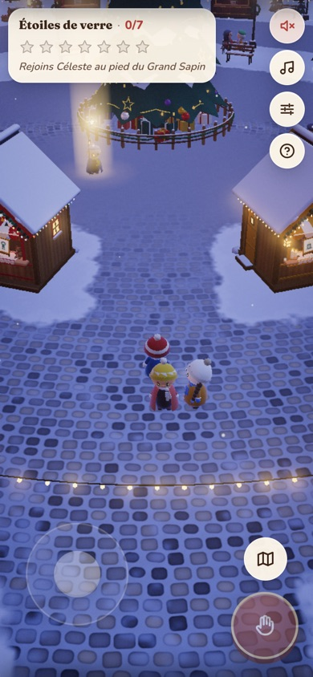<br><em>Sur téléphone : joystick, bouton d'action, toucher le sol pour s'y rendre</em></p>

## Démarrer

```bash
npm install
npm run dev
```

Puis ouvre http://localhost:5173. Quelques raccourcis utiles :

| URL | Effet |
|---|---|
| `/?skipIntro` | saute l'introduction |
| `/?fresh` | repart de zéro (efface la progression) |
| `/?debug` | affiche les fps |
| `/?quality=low` | qualité « téléphone » |
| `/editor.html` | l'Atelier des cabanes |

## Créer son marché

Tout est dans [`content/`](content/) : `market.json` pour le village et une fiche JSON par cabane
dans `content/stalls/`. Le guide complet : **[docs/PERSONNALISER.md](docs/PERSONNALISER.md)**.

```bash
npm run scan      # récupère produits et informations depuis les sites des artisans
npm run build     # génère un site statique dans dist/, à héberger où tu veux
```

## Sous le capot

| | |
|---|---|
| 3D | [Three.js](https://threejs.org) (WebGL 2), modèles 100 % procéduraux, bloom |
| Build | [Vite](https://vite.dev) + TypeScript |
| Interface | DOM et CSS natifs, sans framework |
| Son | Web Audio API : tout est synthétisé, il n'y a aucun fichier audio |
| Dialogue | BM25 et détection d'intentions en français, hors ligne, sans IA |
| Scanner | Node, `node-html-parser` |
| Tests | Vitest et Playwright |

Pas de modèle 3D, pas de son, pas de police à licence : le marché pèse environ 480 Ko compressés, dont 160 Ko pour Three.js.
Il s'héberge sur n'importe quel serveur statique (GitHub Pages, Netlify, Vercel…).
L'architecture est détaillée dans [docs/ARCHITECTURE.md](docs/ARCHITECTURE.md).

## Contribuer

Les contributions sont les bienvenues, voir [CONTRIBUTING.md](CONTRIBUTING.md).

## Licence

[MIT](LICENSE). Les mélodies des chants de Noël sont du domaine public ; les arrangements et la
« Valse de Givrelune » sont sous licence MIT avec le reste du code.

---

<sub>🇬🇧 **Givrelune** is an open-source cosy 3D Christmas market for the web. Each chalet is a real
artisan's shop: products are scraped from their website, and you can talk to the artisans thanks to a
small offline French search engine (no AI). Fork it, edit the JSON files in `content/`, run `npm run build`, host anywhere.</sub>
